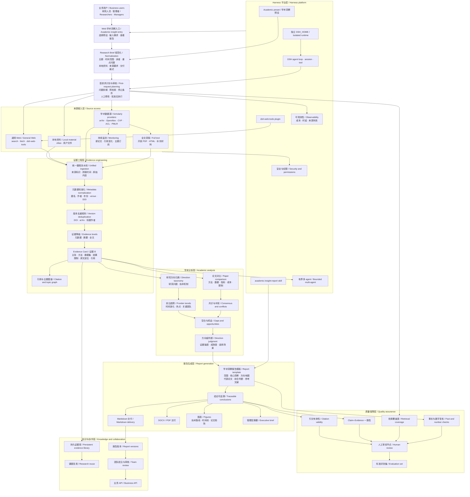

# Academic insight architecture and delivery plan

English | [中文](academic-insight-plan.zh.md)

## Summary

This page stores the non-authoritative working architecture and delivery plan for the Academic insight business. The team can use it to split work, agree on acceptance signals, and report milestone progress; [Academic insight preset](academic-insight.md) remains the source for current product behavior.

## Table of Contents

- [Working plan](#working-plan)

-----

### Dev Note: Working plan

This section is planning material, not a product promise. Update its statuses, milestones, risks, and assignments when the team changes the delivery decision.

#### Architecture map

The architecture map shows target scope, not acceptance status; the milestone table owns progress reporting.

#### Current reading

- As of 2026-10-14, recorded acceptance and the current source show that M0 is available, the M1 plan-to-execution path works but consistency acceptance is incomplete, the main M2 pipeline works but lacks reliability, M3 produces limited drafts rather than approved deliverables, and M4 has not started as a whole. Uncommitted workspace changes do not count as delivered; implementation, tests, real runs, and final delivery remain separate signals.
- A reviewed Chinese Research Brief can drive retrieval. Q7 ran through the real Web entry, but that full-run acceptance did not pass. Scholarly sources, general Web discovery, candidate review and ranking, batch replenishment, and batch-level recovery are implemented; equivalent intent across short and detailed requests and pre-full-text selection quality still need acceptance. See the [Q7 acceptance record](../z-team_docs/开发记录/2026-10-09-zhouzhixian2021-Q7新检索端到端验收.md) and [checkpoint recovery record](../z-team_docs/开发记录/2026-10-09-zhouzhixian2021-A-S3学术研究检查点恢复.md).
- Long-paper fragment extraction and storage of verified fragments are connected to the formal workflow. A controlled whole-paper run using real text retained seven located evidence items, covered two of four questions, took about 18.5 minutes, and left its report at `needs_review`. This establishes a runnable limited-draft path, not acceptance for live sources, multiple papers, or final quality; restart cannot resume inside a fragment. See the [fragment and report record](../z-team_docs/开发记录/2026-10-12-zhouzhixian2021-正式分片证据抽取接入与有限报告核对.md).
- The direction-based Markdown report layout and background research page have implementations and focused tests, but semantic review on a real paper set, final human review, and complete delivery remain open. A, B, and C follow [module responsibilities](../z-team_docs/模块分工/academic-module-ownership.md), rather than the old paused-member status; bounded multi-agent execution and a cross-run shared evidence library remain undelivered.

#### Delivery milestones

| Milestone | Intended outcome and scope | Current progress | Next acceptance signal and gaps | Dependency |
|---|---|---|---|---|
| M0 — Runnable MVP | Academic preset, Web entry, isolated runtime data, general material access, and source-linked Markdown reports. | Available; Web displays research progress and permits draft downloads. | Retain launch and report-viewing regression checks; this does not establish research sufficiency. | None. |
| M1 — Stable research input | Ordinary requests become explicit Research Briefs, reviewed before execution; equivalent intent yields consistent specifications. | Plan approval, Chinese presentation, and approved-query execution work, with a Q7 real-run record; the consistency goal remains open. | Compare plan intent, executed queries, and scope for broad, short, and detailed requests; check agreement between readable text and execution data. | M0. |
| M2 — Evidence pipeline | Scholarly sources, metadata and version deduplication, HTML/PDF parsing, evidence cards, provenance, and source locations. | Mixed retrieval, candidate review and ranking, batch replenishment, full-text parsing, fragment extraction, partial-evidence retention, and batch-level recovery work; a controlled whole-paper run reached a report. | Use a fixed multi-paper set to check selection, question coverage, failure rate, and latency; fragment-level restart and full live-source/Web acceptance remain open. | M1. |
| M3 — Decision-ready report | Cross-paper comparison, trend/conflict/gap analysis, citation and claim checks, figures, executive brief, and DOCX/PDF. | Question-based analysis, a direction-based Markdown layout, and limited drafts with disclosed gaps are implemented; final delivery has not passed. | Review claims against evidence, numbers, and coverage on the same real paper set; complete independent semantic and human review. Figures and DOCX/PDF remain undelivered. | M2. |
| M4 — Reusable research platform | Evidence library, monitoring, report versions, team review, business API, and bounded multi-agent work. | Not started as a whole; Session records and the background research entry are operational foundations, not a cross-run shared evidence library. | Independently accept cross-run evidence and report reuse, incremental monitoring, review history, approved-result delivery, and bounded multi-agent work. | M3. |

Current order: rerun the same broad topic and fixed paper set to verify plan consistency, candidate selection, and question-level evidence coverage. Then reduce M2 fragment timeouts, connection failures, and long latency, and use the same evidence input to accept M3 claims, citations, length, and human review. Batch-level recovery exists; fragment-level resumption needs a separate design. M4 shared storage and operational ownership remain a separate decision.

#### Concise review and tiered-evidence handoff

The first-stage [team plan](../z-team_docs/模块分工/academic-concise-plan-tiered-evidence-team-plan.md) limits user review to research objectives, questions, scope, evidence requirements, and delivery choices that affect the result. Machine queries, provider identities, and internal budgets remain available in folded execution information. A has fixed a [readable-plan and complete-execution sample](../z-team_docs/interface-samples/academic-model-v1/academic-pe1-plan.sample.md). The sample passes existing structural validation; a general semantic-consistency check between readable text and execution data still needs implementation and acceptance.

Tiered evidence reuses existing records, source locations, and question links. The [partial-success and zero-evidence sample](../z-team_docs/interface-samples/academic-model-v1/academic-pe1-evidence.sample.json) aligns inputs and report limits across modules. B has merged minimal extraction, fragment selection with local failure recovery, and same-version second-tier supplementation. A has integrated the first-tier path and selected-paper enhancement into the Controller and workflow, while C has integrated limited drafts and the Web enhancement panel. Scripted cross-module fixtures for three topics cover draft retention after partial failure and stopping on zero evidence; they do not establish real-model quality. B-PE4's same-paper performance baseline and real end-to-end approval, retrieval, report, and enhancement acceptance for all three topics remain open. Model timeouts cannot be solved by hiding failures or weakening citation requirements.

#### Team workstreams

| Workstream | Primary responsibility | Main handoff |
|---|---|---|
| Product and research method | Define Research Brief fields, report questions, evidence expectations, and approval criteria. | Versioned research specification and benchmark topics. |
| Retrieval and providers | Implement scholarly-source connectors, access policy, retries, and source provenance. | Normalized source documents with stable identifiers. |
| Evidence and analysis | Own deduplication, Evidence Cards, comparison, trend, conflict, gap, and confidence rules. | Auditable claims linked to inspected evidence. |
| Web and report experience | Present research input, progress, evidence, report navigation, export, and review states. | User-visible workflow and delivery artifacts. |
| Quality and evaluation | Maintain benchmark topics, invalid-source cases, citation checks, coverage measures, and human review rubrics. | Release evidence and regression signals. |
| Platform and operations | Own runtime isolation, permissions, observability, cost controls, persistence, and later bounded concurrency. | Operable deployments with accountable resource use. |

#### Progress reporting

Each team update records four items: milestone status, completed acceptance signals, the next acceptance signal, and a risk or decision that requires ownership. Leadership reporting uses the same structure and summarizes capability value instead of file-level activity.

Use the architecture map as the scope boundary. A proposed capability enters a milestone only when its owner, dependency, acceptance signal, and required evidence are explicit.
