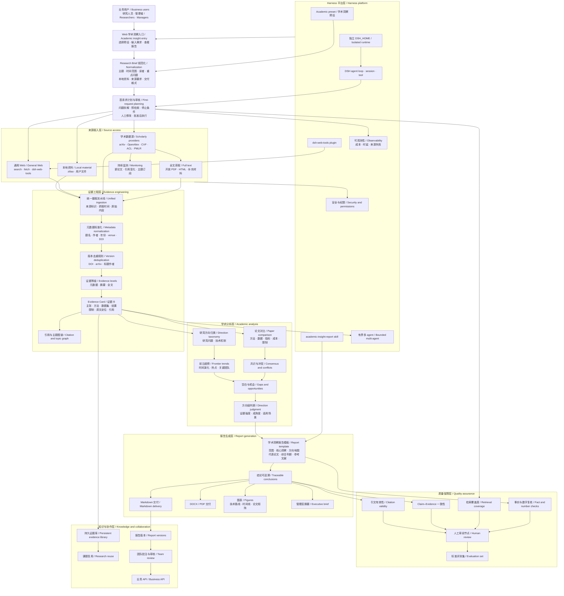

# 学术洞察架构与交付计划

[English](academic-insight-plan.md) | 中文

## 摘要

本页保存学术洞察业务的非权威工作架构与交付计划。团队可以用它拆分工作、约定验收信号并汇报里程碑进展；当前产品行为仍以[学术洞察预设](academic-insight.zh.md)为准。

## 目录

- [工作计划](#working-plan)

-----

### 开发备注：工作计划

本节属于计划材料，不构成产品承诺。团队改变交付决策时，需同步更新状态、里程碑、风险和任务分配。

#### 架构图

架构图展示目标范围，不表示各节点已完成验收；进度以本页里程碑表为准。

#### 当前判断

- 截至 2026-10-14，按已记录验收及当前源码判断：M0 可用，M1 的计划到执行闭环已接通但一致性验收未完成，M2 的主要流水线已接通但可靠性不足，M3 能生成受限草稿而未达到正式交付，M4 尚未整体启动。当前工作区的未提交改动不计作已交付；实现、测试、真实运行和正式交付分别记录。
- 中文 Research Brief 经人工批准后可驱动检索；Q7 已进行真实 Web 运行，但当次整轮验收未通过。学术来源、通用 Web 发现、候选审核与排序、分批补选及按批次恢复已有实现，但短请求与详细请求的等价意图、全文前筛选质量仍需验收。见[Q7 验收记录](../z-team_docs/开发记录/2026-10-09-zhouzhixian2021-Q7新检索端到端验收.md)和[检查点恢复记录](../z-team_docs/开发记录/2026-10-09-zhouzhixian2021-A-S3学术研究检查点恢复.md)。
- 长论文分片证据抽取及已核验片段保存已接入正式工作流；固定真实论文的受控整篇运行得到 7 条可定位证据、覆盖 4 个问题中的 2 个，约耗时 18.5 分钟，报告仍为 `needs_review`。这证明有限草稿路径可运行，不证明实时来源、多篇论文及正式质量已达标；服务重启后不能从单个片段续跑。见[分片与报告核对记录](../z-team_docs/开发记录/2026-10-12-zhouzhixian2021-正式分片证据抽取接入与有限报告核对.md)。
- 方向级 Markdown 报告布局与后台研究页面已有实现和定向测试，真实论文集的语义核验、最终人工审核及完整交付尚未完成。A、B、C 按[模块分工](../z-team_docs/模块分工/academic-module-ownership.md)协作，不再沿用成员暂停的旧状态；有界多 agent 和跨运行共享证据库仍未交付。

#### 交付里程碑

| 里程碑 | 原定结果与范围 | 当前进度 | 下一验收信号与缺口 | 依赖 |
|---|---|---|---|---|
| M0 — 可运行 MVP | 学术预设、Web 入口、隔离运行数据、通用资料访问及带来源的 Markdown 报告。 | 已具备；Web 可展示研究过程和下载草稿。 | 保留启动与报告查看回归；不据此宣称研究充分。 | 无。 |
| M1 — 稳定研究输入 | 普通需求形成明确 Research Brief，人工审核后按计划执行；意图等价的请求形成一致规格。 | 计划审批、中文展示和按获批查询执行已接通，并有 Q7 真实运行记录；一致性目标未完成。 | 对宽泛、简短与详细请求核对计划意图、执行查询和研究范围，并检查可读正文与执行规格一致。 | M0。 |
| M2 — 证据流水线 | 学术来源、元数据与版本去重、HTML/PDF 解析、证据卡、来源及原文定位。 | 混合检索、候选审核与排序、分批补选、全文解析、分片抽取、部分证据保留及批次级恢复已接通；单篇受控整篇运行到达报告。 | 用固定多篇论文核对筛选、逐题覆盖、失败率和耗时；片段级重启续跑、实时来源与 Web 全程复验仍缺失。 | M1。 |
| M3 — 可供决策的报告 | 跨论文对比、趋势/冲突/空白分析、引文与主张核验、图表、管理层摘要及 DOCX/PDF。 | 逐题分析、方向级 Markdown 布局及带缺口说明的有限草稿已实现；正式交付未达标。 | 在相同真实论文集上审核论断与证据、数字和覆盖度，完成独立语义及人工审核；图表与 DOCX/PDF 尚未交付。 | M2。 |
| M4 — 可复用研究平台 | 证据库、监测、报告版本、团队审核、业务 API 和有界多 agent。 | 尚未整体启动；Session 记录和后台研究入口是运行基础，不是跨运行共享证据库。 | 证据与报告跨运行复用、增量监测、审核历史、获批结果交付及有界多 agent 需要独立验收。 | M3。 |

当前顺序：先用相同宽泛课题和固定论文集复验计划一致性、候选筛选及逐题证据覆盖；再针对分片超时、连接失败和长耗时优化 M2，并以同一证据输入验收 M3 的论断、引用、篇幅和人工审核。批次级恢复已有实现，片段级续跑需另行设计；M4 的共享存储与运维责任仍待独立立项。

#### 简洁审批与分级证据交接

第一阶段的[团队方案](../z-team_docs/模块分工/academic-concise-plan-tiered-evidence-team-plan.md)规定：用户只审核影响结果的研究目标、问题、范围、证据要求与交付方式，机器查询、来源标识和内部预算留在可按需查看的执行信息中。A 固定了[可读计划及完整执行块样例](../z-team_docs/interface-samples/academic-model-v1/academic-pe1-plan.sample.md)；样例可通过现有结构校验，但可读正文与执行规格的通用语义一致性检查仍需实现和验收。

分级证据复用现有证据记录、原文定位与问题关联，[局部成功及零证据样例](../z-team_docs/interface-samples/academic-model-v1/academic-pe1-evidence.sample.json)供跨模块对齐输入和报告限制。B 已合入一级最小抽取、片段选择与局部失败恢复、同版本二级补充入口；A 已把一级路径及所选论文二级增强接入 Controller 和工作流，C 已接入有限草稿与 Web 增强页面。三题的脚本化跨模块夹具覆盖部分失败时保留草稿和零证据时停止；它不证明真实模型质量。B-PE4 的同论文性能基线，以及三题真实审批、检索、报告和增强的端到端验收仍待完成。模型超时不能靠隐藏失败或降低引用要求解决。

#### 团队工作流

| 工作流 | 主要责任 | 主要交付 |
|---|---|---|
| 产品与研究方法 | 定义 Research Brief 字段、报告问题、证据要求和审批标准。 | 版本化研究规格与基准主题。 |
| 检索与提供方 | 实现学术来源连接器、访问策略、重试和来源记录。 | 带稳定标识符的规范化来源文档。 |
| 证据与分析 | 负责去重、Evidence Card、对比、趋势、冲突、空白和置信度规则。 | 与已检查证据关联的可审计主张。 |
| Web 与报告体验 | 展示研究输入、进度、证据、报告导航、导出和审核状态。 | 用户可见工作流与交付产物。 |
| 质量与评测 | 维护基准主题、无效来源用例、引文检查、覆盖度指标和人工审核量表。 | 发布证据与回归信号。 |
| 平台与运维 | 负责运行时隔离、权限、可观测性、成本控制、持久化和后续有界并发。 | 资源使用可问责的可运维部署。 |

#### 进展汇报

每次团队更新记录四项内容：里程碑状态、已完成的验收信号、下一个验收信号，以及需要明确责任人的风险或决策。面向领导的汇报沿用相同结构，并汇总能力价值而不是文件级活动。

架构图同时作为范围边界。只有责任人、依赖、验收信号和所需证据都明确时，拟议能力才能进入里程碑。
