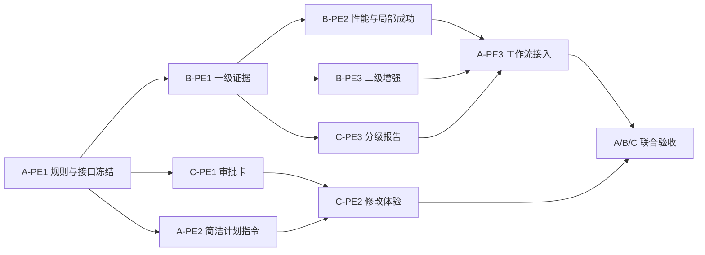

# 学术洞察简洁计划与分级证据团队方案

## 状态与目标

本文规划两项相互依赖的改造：把用户审批内容缩短为可读的研究计划，把证据处理拆成默认最小证据和按需完整证据卡。本文只记录目标设计、模块边界、三人分工和验收标准，不表示产品源码已经实现。

当前审批内容同时承担用户决策和机器执行两种职责。用户需要阅读研究范围、检索参数、候选初筛词和完整 JSON，难以快速判断研究方向是否正确。当前证据流程在报告生成前执行逐篇准入、全文分段、结构化抽取、逐字核验和覆盖检查；模型调用耗时或部分失败可能使有效论文不足，最终不返回报告。

第一阶段以“先生成可追溯草稿，再核验重点结论”为目标。用户只审批影响研究结果的选择，系统执行参数继续完整保存。默认流程保留足以支持报告的最小证据；代表论文、数值比较、冲突结论和正式交付再进入完整 EvidenceCard 与严格审核。

## 设计原则

1. 用户审批研究意图，不审批 Provider ID、字段枚举、候选预算或 JSON。
2. 可读计划和机器执行规格表达同一研究意图，但由不同界面层消费。
3. 最小证据保留论文、问题、陈述、逐字摘录、原文位置和证据等级；不能为缩短输出而删除可追溯信息。
4. 六分区 EvidenceCard 继续作为增强证据产物，不要求每篇候选在生成第一版草稿前填满所有分区。
5. 单条证据、单个片段或单篇论文失败不清除其他有效证据。
6. 有有效证据但未达到批准目标时生成明确标注限制的草稿；零有效证据时停止，不编造报告。
7. 第一阶段优先复用现有 `EvidenceRecord`、`EvidenceQuestionLink`、EvidenceCard、`partial_success` 和草稿状态。新增公共类型或 Session 事件前必须证明现有记录无法表达所需事实。

## 目标流程

默认研究在一级证据后产生草稿。二级证据不是另一套独立来源模型，而是对已选论文和重点结论执行更完整的抽取、比较与审核。

## 简洁审批计划

### 用户可见内容

审批卡只展示以下内容，目标长度为 300 至 600 个中文字符，并尽量在一个常见桌面视口内读完：

1. 研究目标：用户最终需要理解或判断什么。
2. 核心问题：通常三至五个自然语言问题。
3. 研究范围：时间、论文类型、是否接受预印本、资料范围和证据等级。
4. 执行方式：检索、筛选、阅读、比较和成文的四至五个步骤。
5. 交付结果：报告语言、主要章节、引用方式和证据不足时的处理。
6. 待确认事项：只列会实质改变研究结果且必须由用户决定的选项；没有则明确可以开始。

用户可见计划可以用“重点分析约 5 至 8 篇论文”表达研究规模，不分别展示最低、目标、候选上限和最终上限。计划可以说明“学术来源加公开网页补充”，默认不列出 OpenAlex、arXiv 或核验 Provider 名称；用户明确指定来源时才展示该选择。

### 系统执行信息

以下信息继续由系统生成、校验和持久化，但默认不进入审批正文：

- `schemaVersion`、字段枚举和内部标识；
- 英文检索表达式、别名和 `candidateScreening` 词项；
- Academic Provider 与引用核验 Provider ID；
- 每条查询的 Web 结果和引用核验上限；
- 最低、目标和最大候选或纳入数量的独立字段；
- 饱和轮次、停止开关和内部超时；
- 报告章节枚举、布尔开关和完整 `academic-research-brief-json`。

第一阶段保留现有批准计划中的结构化执行块，Controller 继续按原格式解析。Web 审批卡默认只渲染可读正文，把执行块放入折叠的“系统执行信息”；计划生成指令不得在正文重复逐项解释内部参数。只有真实使用证明折叠方案仍无法维护一致性时，后续工作才评估把 `displayPlan` 与 `executionSpec` 拆成独立工具字段或 Session 事件。

### 自然语言修改

用户使用“时间改为近三年”“增加效率和成本比较”“不纳入预印本”等自然语言修改计划。系统重新生成完整可读计划和执行规格，并保持两者一致。界面不要求用户编辑 JSON、查询表达式、Provider ID 或字段枚举。

## 分级证据

### 一级：最小证据

一级证据用于尽快形成可靠草稿。论文准入判断与证据生成保持独立；准入结果只回答 `included`、`excluded` 或 `needs_more_context` 及理由，不同时生成完整证据卡。

每篇纳入论文默认提取三至五条与批准问题直接相关的证据。每条保留以下事实：

- 论文和实际内容版本；
- 关联的批准研究问题；
- 证据类别，例如方法、结果、限制或背景；
- 可进入报告的简洁陈述；
- 来源中的逐字摘录；
- 页码、章节或段落位置；
- 摘要或全文证据等级；
- 支持、反对或背景关系。

一级证据优先复用现有证据记录和问题关联。模型不需要为每条结果填写六分区全部属性；未抽取字段保持 `not_extracted`。摘要级材料可以支持背景和候选说明，不能支持必须依赖全文的数值结论。

### 二级：完整证据卡

二级处理保留现有六分区 EvidenceCard，用于以下情况：

- 方向中的代表性论文；
- 报告的核心结论或关键数字；
- 多篇论文之间存在不一致或冲突；
- 用户要求深入分析某篇论文；
- 草稿准备进入人工审核或正式交付；
- 证据准备进入可复用的持久证据库。

二级处理可以补充研究问题、核心主张、方法、数据集与评测、研究发现、限制与未来方向。完整卡片不能把一级证据中未经核验的内容提升为全文事实。

### 失败与交付规则

- 单条草稿的摘录无效时只拒绝该条，保留同一响应中的其他有效证据。
- 单个片段失败时保留同一论文其他片段已经核验的证据。
- 一篇论文失败时继续处理其他论文。
- 一篇论文至少保留一条有效一级证据时，可以参与有限草稿；报告明确显示证据等级和覆盖限制。
- 有有效证据但论文、全文或逐题覆盖未达到批准目标时，使用现有警告或部分成功状态返回草稿。
- 零有效证据、用户取消或持久化失败时不生成研究结论。
- 正式报告继续要求完整证据、必要审核和现有交付条件；简化一级证据不能自动授予正式交付资格。

## 三人分工

三人各承担 8 个工作点。工作点用于比较相对工作量，不代表工时承诺。各成员在自己的默认目录内实现和测试，避免同时修改高冲突文件。

### 成员 A：计划生成、共享规则与工作流集成，共 8 点

| 工作包 | 工作内容 | 主要目录 | 工作点 |
|---|---|---|---:|
| A-PE1 | 冻结可读计划与执行规格的一致性规则；确认一级证据优先复用哪些现有类型和状态，只在无法表达时修改共享模型。 | `packages/academic/model/`、正式 Academic 文档 | 2 |
| A-PE2 | 精简 Academic Skill 和 Research Brief 编写指令，使正文只生成用户决策内容，结构化执行块保持完整且不在正文重复。 | `packages/preset/agent-presets/presets/academic/` | 2 |
| A-PE3 | 在 Controller 和工作流接入一级与二级处理选择、部分成功草稿准入、重点论文升级条件及取消和持久化语义。 | `packages/api/academic-research-controller/`、`packages/academic/workflow/` | 3 |
| A-PE4 | 维护跨模块固定夹具，合并 B、C 后执行三个基准课题的端到端验收并更新正式架构事实。 | Controller 与 Workflow 集成测试、`docs/academic-insight*` | 1 |

A 独占共享模型、Academic Preset、Controller 和 Workflow。B、C 通过接口需求和固定夹具提出变更，不直接修改这些高冲突目录。

### 成员 B：一级抽取、二级增强与性能，共 8 点

| 工作包 | 工作内容 | 主要目录 | 工作点 |
|---|---|---|---:|
| B-PE1 | 定义并实现一级最小证据的生产接口，复用现有来源定位、证据记录和问题关联，限制每篇证据数量并逐条隔离无效草稿。 | `packages/academic/evidence/` | 3 |
| B-PE2 | 优化正文片段选择、批次大小和缩小输入重试；保证已核验证据在后续片段失败时仍然保留。 | `packages/academic/evidence/` | 2 |
| B-PE3 | 实现从一级证据补充为六分区 EvidenceCard 的二级入口，确保增强处理不覆盖原始来源、版本、摘录和定位。 | `packages/academic/evidence/` | 2 |
| B-PE4 | 使用固定成功与失败论文建立耗时、调用次数、有效证据率、超时和输出上限回归基线，向 A 提供工作流接入事实。 | Evidence 测试与负责人开发记录 | 1 |

B 不决定报告是否正式交付，也不在 Evidence 包内选择模型或写 Session 事件。B 的接口必须允许 A 选择一级或二级处理，并返回局部成功结果。

### 成员 C：审批体验、分析报告与产品验收，共 8 点

| 工作包 | 工作内容 | 主要目录 | 工作点 |
|---|---|---|---:|
| C-PE1 | 设计一屏内审批卡，只显示目标、问题、范围、步骤、交付和待确认事项；系统执行块默认折叠，并保留按需查看入口。 | `packages/client/ui-academic-research/` 及计划相关客户端 | 2 |
| C-PE2 | 接入自然语言计划修改体验，验证用户不接触 JSON、Provider ID、枚举和内部预算也能完成批准或修改。 | Academic Web UI 与客户端测试 | 2 |
| C-PE3 | 让分析和报告消费一级证据并显示证据等级、未满足问题和有限草稿声明；二级证据支持重点结论、数字和正式审核，不把一级材料伪装成完整卡片。 | `packages/academic/analysis/`、`report/`、`eval/` | 3 |
| C-PE4 | 维护完整、部分成功和零证据的报告夹具，完成审批可读性测试、报告状态测试和真实 GUI 录制。 | C 所属测试、快照和 GUI 证据 | 1 |

C 不解析或改写执行 JSON，不从页面推断证据等级或报告质量。Web 使用 A 返回的投影和 C 所属分析、报告结果。

## 依赖与合并顺序

1. A 先合并 A-PE1 的规则和固定接口样例。
2. B 开发一级证据，C 使用固定计划和证据夹具并行开发审批卡与报告消费；A 同时精简计划指令。
3. B 合并一级证据和性能修复，C 合并分级报告与 Web 展示。
4. A 在独立集成改动中接入 Controller 和 Workflow，不要求 B、C共同修改高冲突文件。
5. 三人使用相同基准课题完成真实审批、研究、有限草稿和二级增强验收。

## 第一阶段验收标准

### 审批计划

1. 普通研究请求生成的用户可见计划为 300 至 600 个中文字符；复杂请求超过目标时，正文仍只包含用户决策，详细执行信息进入折叠区域。
2. 用户不阅读或编辑 JSON、查询表达式、Provider ID、枚举和内部数量预算，也能批准或用自然语言修改计划。
3. 可读计划明确说明目标、问题、时间与论文范围、是否允许预印本、证据要求、交付内容和证据不足处理。
4. 修改时间、问题、预印本政策或报告要求后，可读计划与执行规格同步变化；Controller 拒绝二者不一致或执行块无效的计划。
5. 旧批准计划继续按现有规则读取；第一阶段不要求迁移已提交的 Session 数据。

### 分级证据

1. 论文准入判断和证据生成使用独立模型任务，准入失败不会产生伪证据。
2. 一级抽取每篇最多返回五条证据，每条都能关联批准问题并通过逐字摘录和来源位置核验。
3. 单条、单片段或单篇失败不会清除其他有效证据；真实结果准确区分成功、部分成功和失败。
4. 至少存在一篇论文和一条有效一级证据，且批准策略允许带警告继续时，工作流返回有限草稿而不是因为未填满 EvidenceCard 停止。
5. 关键数字、跨论文冲突和正式报告只能使用满足对应证据等级与审核要求的材料。
6. 二级增强保留六分区 EvidenceCard，并能从同一论文的一级证据补充信息而不改变原始来源和定位。

### 效率与产品结果

1. 使用相同论文、相同研究问题和相同模型，记录改造前后的模型调用次数、输入与输出 token、单篇耗时、超时数、有效证据数和报告返回状态。
2. 一级路径的证据模型调用次数和中位耗时必须低于现有完整分片路径；目标值在 B-PE4 建立真实基线后由 A 写入验收记录，不在实现前虚构百分比。
3. 三个固定课题都能在部分来源或部分论文失败时给出可读草稿和准确限制；零有效证据用例明确停止。
4. 二级处理只针对系统或用户选定的论文与结论执行，不默认重新处理全部候选。

## 第一阶段不做

- 不删除六分区 EvidenceCard 或现有已发布 Session 数据。
- 不建立新的数据库或跨研究持久证据库。
- 不增加学术来源 Provider。
- 不重做检索排序、实时进度或检查点恢复。
- 不让一级证据自动取得正式报告资格。
- 不在缺少真实基线时承诺固定速度提升比例。
- 不立即修改通用 `exit_plan_mode` 工具；先验证 Academic Web 的可读正文与折叠执行信息。

## 与其他计划的关系

本方案复用[学术洞察报告模板适配计划](academic-report-template-plan.md)的方向级报告和交付状态，不重新定义报告目录。C-PE3 对应其中 R2 至 R5 的第一阶段内容，但优先保证一级证据能够形成有限草稿。HTML、PDF 和论文原图继续留在报告模板计划的后续阶段。

本方案不改变[新检索词流程与候选排序计划](academic-hybrid-retrieval-query-workflow-plan.md)的混合检索、去重和 P0/P1/P2 排序。检索结果进入一级证据后尽快形成草稿，二级增强再消费重点论文。

模块目录和最终修改人继续遵循[学术洞察模块总览](academic-module-ownership.md)。如实施发现工作点明显失衡，A 可以在不改变目录所有权的前提下调整测试、夹具和文档工作，不能让两名成员并行修改同一高冲突目录。
