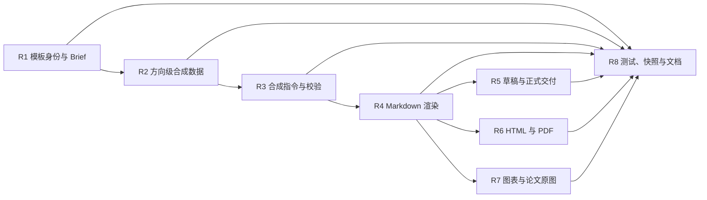

# 学术洞察报告模板适配模块计划

## 状态与目标

本文根据团队提供的《Agent 学术洞察模板》记录报告模板适配的模块范围、依赖和验收标准。本文只划分工作包，不指定成员或负责人，也不表示相关源码已经实现。

目标是让学术研究报告按“研究范围—总体洞察—方向地图—分方向分析—跨方向综合—总结—参考文献”的层级组织内容，并让每项论文事实、数值结果、方向判断和工程启示能够追溯到已核验证据。

## 参考模板的信息层级

参考模板包含以下稳定层级：

1. 封面：报告标题、副标题、主题词、研究范围和报告时间。
2. 开篇：洞察方法、总体判断、核心变化和方向地图。
3. 分方向分析：方向概述、当前关注点、代表论文、核心机制、关键结果、方向判断和工程或应用启示。
4. 跨方向综合：共同状态、依赖关系、矛盾、系统结构和未来趋势。
5. 收尾：证据缺口、总结、编号参考文献，以及可选证据附录和检索过程披露。

报告以研究方向为主要组织单位。论文列表是方向判断的证据，不作为报告的一级目录。不同论文的数值只有在任务、数据集、指标和实验条件可比时才能进入同一比较表或排序。

## 当前基础与缺口

[Academic 报告格式说明](../../packages/preset/agent-presets/presets/academic/skills/academic-insight-report/references/report-format.md)已经描述封面、方向地图、代表论文、核心机制、关键结果、方向判断和工程启示，但正式工作流只消费获批 Brief、已核验证据和通用合成章节。仅修改 Skill 或格式说明不能约束工作流生成结果。

当前问题驱动合成使用扁平的分析段落、逐题回答和章节索引，不能稳定表达多个重复的研究方向对象。报告生成器输出 Markdown，并附带质量检查、参考文献、证据附录和检索过程披露；Web 只提供通用 HTML 查看与 Markdown 下载。论文 PDF 解析按页提取文字，不提供可直接嵌入报告的图片资源。

## 目标报告结构

第一阶段的 Markdown 报告使用以下顺序：

```text
封面信息
执行摘要
洞察方法与证据范围
方向地图
研究方向 1..N
  方向概述
  当前关注点
  代表论文
  核心机制
  关键结果
  方向判断
  工程与应用启示
跨方向综合洞察
未来研究问题与证据缺口
总结
参考文献
证据附录
检索过程披露
```

有限草稿、待审草稿和正式报告复用相同正文结构。有限草稿在标题之后披露未满足的 Plan 数量或覆盖要求；待审草稿披露尚未完成的语义审核和逐题内容审核；正式报告只在证据、覆盖、审核、非合成数据和篇幅要求全部满足后生成。

## 模块 R1：模板身份与 Research Brief

目的：让用户批准的计划明确选择报告模板，避免报告生成器依赖隐藏默认值。

涉及文件：

- `packages/academic/model/src/types.ts`
- `packages/api/academic-research-controller/src/research-brief-plan.ts`
- `packages/preset/agent-presets/presets/academic/skills/academic-insight-report/references/research-brief.md`

建议在 `ReportRequirements` 增加版本化模板标识，例如 `academic_frontier_v1`。Brief 继续保存语言、篇幅、引用格式、证据附录、方法、局限和研究空白要求；模板标识只选择信息层级，不改变研究问题或证据门槛。

验收标准：计划页面能够显示并审核模板选择；未知模板在执行前明确失败；旧 Brief 的读取策略在实施前单独确定并测试。

## 模块 R2：方向级合成数据

目的：用结构化方向对象表达参考模板中的重复章节，避免模型使用自由 Markdown 决定目录和证据关系。

涉及文件：

- `packages/academic/analysis/src/synthesis-types.ts`
- `packages/academic/analysis/src/synthesis-input.ts`
- `packages/academic/analysis/src/types.ts`
- `packages/academic/analysis/src/index.ts`

方向对象至少表达方向标题、概述、关注点、代表论文、核心机制、关键结果、方向判断和工程启示。正文内容继续引用经过校验的分析段落；代表论文引用 `AcademicWorkId`，关键结果和判断引用 `statementIndexes` 或 `evidenceIds`，不能保存无法追溯的自由文本。

验收标准：同一报告能够包含多个方向；一个分析段落可以被逐题回答和方向章节复用；方向对象不能引用输入之外的论文、段落或证据。

## 模块 R3：合成指令与结构校验

目的：让模型按照方向模板生成结构化 JSON，并在证据不足时保留明确缺口。

涉及文件：

- `packages/academic/analysis/src/synthesis.ts`
- `packages/academic/analysis/src/synthesis-parse.ts`

合成指令要求区分单篇论文陈述和跨论文综合。跨论文判断至少使用两篇独立论文的支持证据；数值结果必须来自全文、表格或图片对应的已核验证据，并携带指标、数据集和实验条件。缺少材料的方向或小节使用明确的 `missingReason`，不能生成无证据的填充内容。

验收标准：解析器拒绝未知论文、越界索引、无证据的实质判断、缺失必要章节和错误章节顺序；有限草稿仍覆盖每个获批研究问题并明确标出部分回答或未回答。

## 模块 R4：Markdown 模板渲染

目的：把通过结构校验的方向数据渲染为稳定、可下载、可比较的中文报告。

涉及文件：

- `packages/academic/report/src/synthesis-render.ts`
- `packages/academic/report/src/index.ts`
- 建议新增 `packages/academic/report/src/frontier-template.ts`

渲染器负责封面元数据、方向地图、方向章节、编号引用、证据附录和有限报告声明。模型只生成内容数据，不直接生成最终 Markdown 标题、编号、引用链接或质量声明。现有检索过程披露继续作为报告尾部附录，不把 Web 发现 URL 提升为学术参考文献。

验收标准：相同结构化输入产生确定性 Markdown；每篇引用论文进入参考文献；每项实质陈述能够跳转到证据；空方向和不可比较指标不会生成误导性表格或排名。

## 模块 R5：草稿与正式交付状态

目的：把正文格式和交付资格分开，防止“生成了 Markdown”被解释为“正式报告通过”。

涉及文件：

- `packages/academic/eval/src/`
- `packages/academic/report/src/index.ts`
- `packages/academic/workflow/src/pipeline.ts`，仅在正式交付入口或审核状态需要接线时修改

有限草稿保留未满足 Plan 的数量、全文、覆盖和篇幅问题；待审草稿保留来源陈述审核与逐题内容审核；正式报告要求当前证据有效、引用可定位、覆盖达标、必要审核通过、数据非合成且篇幅合格。问题驱动正式报告需要独立的逐题审核输入，不能通过隐藏默认值将 `needs_review` 提升为 `ready`。

验收标准：三种交付状态具有不同且稳定的机器状态和可见声明；被阻止的正式交付可以保留已有草稿，但不能标记为正式报告。

## 模块 R6：HTML 与 PDF 视觉模板

目的：在内容模板稳定后，提供接近参考模板的封面、蓝色标题层级、表格、图注、页眉、页码和 A4 分页。

涉及文件：

- 建议新增 `packages/academic/report/src/frontier-html-render.ts`
- 建议新增 `packages/academic/report/src/frontier-pdf-render.ts`
- `packages/client/ui-academic-research/src/client/render.ts`
- `packages/client/ui-academic-research/src/client/RunPanel.tsx`
- `packages/client/ui-academic-research/src/client/RunPanel.module.css`

第一版先生成自包含 HTML，再通过固定打印样式输出 PDF。Web 保留 Markdown 下载，并根据后端实际提供的产物增加 HTML 或 PDF 下载；页面不能在客户端重新推断报告质量。

验收标准：封面、目录层级、表格、引用、附录、页码和分页在中文环境下可读；下载文件与页面显示使用同一份报告数据；渲染后不存在文字截断、表格越界、图片模糊或链接失效。

## 模块 R7：图表与论文原图

目的：在来源、版权和定位信息可靠时，为代表论文展示机制图或关键结果图。

涉及文件：

- `packages/academic/evidence/src/fetched-pdf.ts`
- `packages/academic/evidence/src/types.ts`
- `packages/academic/model/src/types.ts`
- `packages/academic/evidence/src/extract.ts`

当前 PDF 解析只生成按页文本片段。第一版不复制论文图片，只展示图号、表号、页码、标题和原文链接；已核验的结构化数值可以重新绘制简单图表。自动嵌入论文原图需要新增图片资源、来源许可、内容哈希、图注和页码关联，并单独评估版权与缓存策略。

验收标准：任何图表都能追溯到具体论文版本和来源位置；重绘图表保留指标单位、实验条件和数据来源；不可比较结果不进入统一排名。

## 模块 R8：测试、快照与文档

涉及文件：

- `packages/academic/analysis/tests/synthesis.spec.ts`
- `packages/academic/report/tests/synthesis.spec.ts`
- `packages/academic/report/tests/delivery.spec.ts`
- `packages/client/ui-academic-research/tests/page.client.spec.ts`
- `snapshots/sdk/academic-limited-draft/`
- `packages/academic/analysis/README.md` 与 `README.zh.md`
- `packages/academic/report/README.md` 与 `README.zh.md`
- `docs/subsystems/academic-insight.md` 与 `academic-insight.zh.md`
- 对应的 Agent Note 与 `z-team_docs/开发记录/`

固定样例至少覆盖完整方向报告、证据有限草稿、待审草稿、正式交付拒绝、空方向、不可比较数值、缺失全文、被拒证据和中英文界面。任何模型可见指令或产品可见报告结构变化都更新录制会话快照；GUI 变化按仓库要求使用真实服务流程录制 GIF。

## 依赖顺序



R1 至 R5 构成内容模板最小闭环。R6 和 R7 在 Markdown 格式与报告质量状态稳定后实施，避免视觉实现反向决定证据和分析数据结构。

## 第一阶段验收标准

1. 用户批准的 Brief 明确选择版本化报告模板。
2. 报告按研究方向组织，不按论文逐篇堆叠。
3. 每个方向具有概述、关注点、代表论文、核心机制、关键结果、方向判断和工程启示，缺失内容明确说明证据不足。
4. 数值结果包含指标、单位、数据集或任务、实验条件、论文版本和证据位置。
5. 跨论文结论引用至少两篇独立论文；单篇论文陈述不会伪装成领域共识。
6. 有限草稿、待审草稿和正式报告使用相同正文层级，但具有不同质量状态和可见声明。
7. 参考文献、证据附录和检索过程披露能够追溯到实际运行数据。
8. 固定样例和真实小范围研究均能生成结构稳定的 Markdown，并通过报告与文档检查。

## 待决定事项

- `ReportRequirements` 中模板字段的最终名称以及旧 Brief 的读取策略。
- 第一版默认生成的研究方向数量及上限。
- 代表论文是每个方向固定一篇，还是允许一至三篇。
- 第一版是否只提供 Markdown，或同时提供自包含 HTML。
- PDF 使用浏览器打印还是独立服务端渲染器。
- 论文原图是否允许缓存和嵌入，以及相应许可记录方式。
- 问题驱动正式报告的逐题审核数据结构与人工审核入口。

上述事项不影响先完成 R1 至 R4 的接口设计，但在写入公共类型或 Session 数据前必须确定。

## 本轮范围

本轮只记录模块计划、依赖、文件范围和验收标准，不修改产品源码，不分配成员，不改变当前报告输出，也不把仓库外部 PDF 作为运行时依赖。
